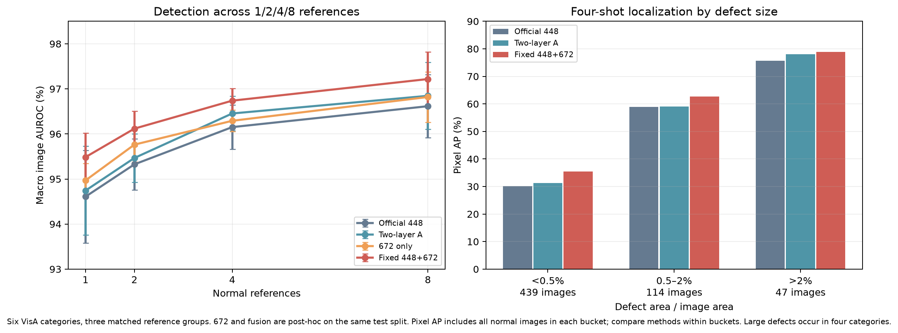
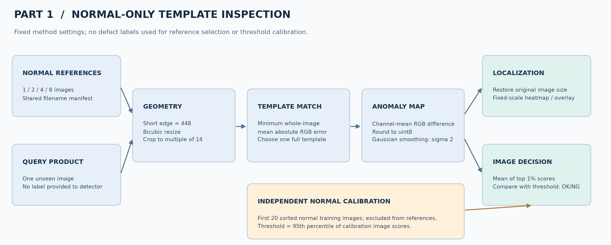

# AIAA3201 Project 2 — Few-Shot Industrial Visual Anomaly Detection

本目录包含 **Part 1：RGB 模板差分基线**、**Part 2：官方 AnomalyDINO 复现** 和 **Part 3：改进与可靠性实验**。
另有两个独立的可选扩展：**Part 1 卷积自编码器**、**Part 2 AnomalyCLIP**。
以下命令均在本仓库根目录的 PowerShell 中运行。

## 公开仓库：内容与复现

本仓库发布课程项目的实现、依赖、固定参考名单、测试、方法说明和少量代表性结果。
数据集、模型权重、特征缓存、虚拟环境与完整逐图实验输出保留在本机，并由 `.gitignore` 排除。
**Part 1、Part 2 和 Part 3 的主要评估已完成。Part 3 的预先固定主改进是双层 DINOv2 特征 A；448+672 多尺度、AnyUp、D/F 与 B/C/E 属于独立的补充或探索实验，监督和验证范围在报告中分别说明。**

- [Part 1 / Part 2 要求核对与关键分析](docs/part1_part2_requirements_and_analysis.md)
- [实验结果摘要与代表图](docs/RESULTS.md)
- [Part 1 独立说明](Part1/README.md) / [Part 2 独立说明](Part2/README.md)
- [完整流程总结](docs/WORKFLOW.md)
- [Part 3 实验设置和当前结果](part3/PILOT_RESULTS.md) / [D、F 完整对比与限制](part3/DF_RESULTS.md) / [B、C、E 初步实验](part3/BCE_PILOT.md)
- [第三方代码、预训练模型及数据来源](THIRD_PARTY_NOTICES.md)
- [最终 CVPR 格式报告（LaTeX 与 PDF）](report/README.md)

### 最终报告与演示

- [报告 PDF](report/main.pdf)：正文 8 页，参考文献第 9 页；摘要末尾含公开仓库完整地址。
- [Part 3 实验与审阅记录](report/FINAL_REVIEW_V4_RESPONSE_2026-11-24.md)：说明主实验、探索性实验和提交核验。
- 交互式单图命令：`.\.venv-part2\Scripts\python.exe -m part3.demo --image data/VisA_pytorch/1cls/candle/test/good/0011.JPG --category candle --shots 4 --seed 0 --mode multilayer --map-restoration official`。输出图像级分数、正常阈值、OK/NG、热力图及叠加图。可替换 `--image` 和对应 `--category`。
- Canvas 演示包 `anomaly_demo.zip` 在本地由 `python tools/build_submission_demo.py` 生成，含 25 秒的真实预测结果演示视频、三张代表性输出及逐例 CSV。数据集和预训练权重需按下文准备，演示包不包含原始数据。

四张正常参考图、三组参考库时，官方 DINO 的六类宏平均图像 AUROC 为 **96.15 ± 0.49%**，预先固定的双层 A 为 **96.45 ± 0.38%**。后验多尺度 448+672 为 **96.74 ± 0.27%**，但四张参考图的阈值错判仅从 365 降到 362，并有新增正常品误报。三组精确原图尺寸像素 AP：官方 **47.93%**、A **48.59%**、A+AnyUp **58.69%**。详细设置、耗时和负结果见报告。



新电脑可以按下面的顺序准备（本次实测 Python 3.11、CUDA PyTorch 2.7.1）：

```powershell
conda create -n aiaa3201 python=3.11 -y
conda activate aiaa3201
python -m pip install torch==2.7.1 torchvision==0.22.1 --index-url https://download.pytorch.org/whl/cu126
python -m venv --system-site-packages .venv-part2
.\.venv-part2\Scripts\python.exe -m pip install -r requirements-part2.txt -r requirements-extensions.txt
.\.venv-part2\Scripts\python.exe tools/setup_third_party.py
```

从 [VisA 官方数据说明](https://github.com/amazon-science/spot-diff) 下载数据，解压到
`data/VisA/`，确认存在 `data/VisA/split_csv/1cls.csv`，然后运行：

```powershell
.\.venv-part2\Scripts\python.exe -m anomaly_baseline.prepare
.\.venv-part2\Scripts\python.exe run_part1.py
.\.venv-part2\Scripts\python.exe run_part2.py

# 两个选做扩展分别运行
.\.venv-part2\Scripts\python.exe Part1/run_autoencoder.py
.\.venv-part2\Scripts\python.exe tools/download_clip_weights.py
.\.venv-part2\Scripts\python.exe Part2/run_anomalyclip.py
```

DINOv2 在首次运行时下载预训练权重；AnomalyCLIP 的官方提示权重随固定版本的第三方仓库取得，
CLIP 骨干由单独下载脚本获取并校验。详细配置与监督条件见后文及扩展说明。

## 两个可选扩展

两个扩展的算法、运行和 Demo 已分开放置：

- **Part 1**：[Part1/README.md](Part1/README.md)，自编码器实际代码在 `Part1/autoencoder/`。
- **Part 2**：[Part2/README.md](Part2/README.md)，AnomalyCLIP 实际代码在 `Part2/anomalyclip/`。

完整方法、训练用图数量、AnomalyCLIP 权重来源和运行命令见 [扩展说明](docs/optional_extensions.md)。
统一结果入口是 `results/extensions/report.html`，逐图 CSV 和权重分别在
`results/part1_autoencoder`、`results/part2_anomalyclip`。

```powershell
.\.venv-part2\Scripts\python.exe Part1/demo_autoencoder.py
.\.venv-part2\Scripts\python.exe Part2/demo_anomalyclip.py
```

自编码器使用 2813 张正常拟合图、312 张正常验证图，单独训练六个小模型；
AnomalyCLIP 使用官方 MVTec AD 训练的提示权重，对 VisA 不训练、目标参考图数为 0。
两者均使用每类额外 20 张正常图片校准阈值。它们作为不同监督条件的补充实验，
不冒充 1/2/4/8-shot 对照，也不替代最终项目的 Part 3。

### 可选扩展的三个种子

两个扩展支持 `--seed`。使用种子 0、1、2 的完整独立重复实验：

```powershell
.\.venv-part2\Scripts\python.exe tools/run_optional_multiseed.py
.\.venv-part2\Scripts\python.exe tools/audit_optional_multiseed.py
.\.venv-part2\Scripts\python.exe tools/write_optional_multiseed_report.py
```

输出分别在 `results/part1_autoencoder_multiseed/seed_0` 至 `seed_2` 和
`results/part2_anomalyclip_multiseed/seed_0` 至 `seed_2`，保留原来的 seed111 结果。
自编码器固定拟合、验证和校准图片，改变模型初始化与训练顺序；AnomalyCLIP 使用同一固定权重重复推理。
这些 seed 的含义与必做方法的参考分组不同。汇总先对六类等权平均，再计算三个种子的均值和样本标准差。
逐图预测、全部训练图片名单和每轮训练损失均保留；详细结果见 [三种子实验说明](docs/optional_multiseed.md)。

## 环境

```powershell
conda activate aiaa3201
python -m pip install -r requirements-part1.txt
```

Part 1 的**必做模板方法**只需要 NumPy、Pillow、OpenCV，使用 CPU，不需要训练或下载模型权重。
Part 1 自编码器选做、Part 2 及其选做使用上述 CUDA 环境。

## 数据准备

原始数据保留在 `data/VisA`。验证报告是 `data/visa_validation.json`。
按照原始包的 `split_csv/1cls.csv` 整理六个必做类别，不自行重新划分测试集：

```powershell
python -m anomaly_baseline.prepare
```

输出：

- `data/VisA_pytorch/1cls/<category>/train/good/`
- `data/VisA_pytorch/1cls/<category>/test/good/`
- `data/VisA_pytorch/1cls/<category>/test/bad/`
- `data/VisA_pytorch/1cls/<category>/ground_truth/bad/`
- `configs/reference_manifest.json`：两部分必须共用的参考图和校准图名单。

掩码按官方准备方法将所有非零类别值转换为 255。正常测试图的掩码在评估时生成为全零。
原始数据不修改；重复准备时验证现有内容，拒绝静默覆盖不同文件。

| 类别 | 正常训练图 | 正常测试图 | 异常测试图 |
|---|---:|---:|---:|
| candle | 900 | 100 | 100 |
| capsules | 542 | 60 | 100 |
| cashew | 450 | 50 | 100 |
| chewinggum | 453 | 50 | 100 |
| fryum | 450 | 50 | 100 |
| pipe_fryum | 450 | 50 | 100 |

每类训练文件按原文件名排序，前 20 张只作 Demo 阈值校准，**不得作为参考图或用于拟合模型**。
参考候选池剔除这 20 张后，使用当前官方 AnomalyDINO 的确定性选择规则：
`pool[seed * shots : (seed + 1) * shots]`，shots 为 1/2/4/8，seed 标识为 0/1/2。
这里的 seed 是官方选择规则中的参考分组标识，不代表本实现另外进行了随机抽样。
不同 seed、shot 的名单不要求相互嵌套；Part 2 必须直接读取或核对这个 manifest。

## Part 1 方法



1. 使用 PIL bicubic 将输入短边缩放到 448，按 DINOv2 官方几何预处理将底部/右侧裁到 14 的整数倍。保持纵横比，不拉伸成固定正方形。
2. 对每张参考图做相同几何处理。若参考图和查询图最终尺寸不同，将已处理模板双线性缩放到查询尺寸以便逐像素比较。
3. 计算查询图和每张模板的全图 RGB 平均绝对差，选择误差最小的一张**完整模板**；不逐像素拼接不同模板。
4. 将这张模板的逐像素 RGB 绝对差做通道平均、四舍五入为 uint8，再用固定 sigma=2 的高斯平滑得到 uint8 异常图。
5. 图像分数为工作分辨率下最高 `ceil(1% * 像素数)` 个平滑差值的均值 / 255。
6. 使用该组参考图对 20 张独立校准图计算分数，以第 95 百分位（线性插值）为阈值。`score > threshold` 为 NG，否则为 OK。
7. 异常图以 uint8 双线性插值恢复到原图尺寸，供 Pixel AUROC 和原图叠加使用。

该基线不使用图像配准、形态学过滤、参考图旋转增强或 DINOv2 的 PCA 前景掩码。
这些属于明示的方法差异；两部分共用官方数据划分、参考图、输入几何分辨率和评估定义。
Part 2 仍需保留其要求的官方 `agnostic` 方法内部处理，不能为了对齐基线而关闭。
参数在完整测试评估前固定，不根据测试指标挑选参数。

## 运行实验

先跑一个完整类别的单配置检查：

```powershell
python -m anomaly_baseline.run --categories cashew --shots 1 --seeds 0 --output results/part1_smoke
```

完整 Part 1（6 类 × 4 shots × 3 seeds = 72 配置）：

```powershell
python -m anomaly_baseline.run
```

每个配置都评估该类别的全部正常和异常测试图；合计 11,520 次测试预测。
可以在中断后运行相同命令，已完整保存的配置会跳过。改变方法或 manifest 后请使用新的 `--output` 目录。
中断时尚未完成的配置会重新执行；不调用其他课程环境，不结束其他进程。

输出位于 `results/part1`：

- `report.html`：本地结果页面、方法配置和困难案例。
- `summary_by_category.csv`：每类、每个 shot 的三 seed 均值和标准差。
- `summary_macro.csv`：每个 seed 先对六类等权平均，再报告三 seed 的均值和标准差。
- `metrics_all.json`、`run_config.json`：全部指标、运行环境、方法和 manifest 指纹。
- `<category>/shot_<k>/seed_<s>/metrics.json`：每组图像/像素 AUROC、误报漏报数、耗时及参考名单。
- 同目录下的 `predictions.csv`、`calibration.csv`：每张图的原始分数和阈值。
- 同目录下的 `maps/good/`、`maps/bad/`：所有测试图的原始 uint8 异常分数 PNG；不是彩色可视化。
- `pixel_score_histograms.npz`：正负像素在每个实际输出分数上的计数，可独立复核 Pixel AUROC。
- `examples/`、`examples.json`：优先选 4-shot seed 0，每类选择一个真实错误（否则选接近阈值的正确样例），最多五类。

## 指标与计时说明

- AUROC 为 0–1 数值，越大越好；使用连续图像分数，不使用 OK/NG 结果计算。
- Pixel AUROC 包含正常图的所有背景像素。各类别单独计算，再等权平均，不能将六类像素池直接合并。
- 本方法**定义**的像素输出为 256 级 uint8，使用 256-bin 正负像素计数精确计算 AUROC，并给相同分数的正负对计 0.5。这里没有为了计算指标而额外近似连续分数。Part 2 若输出 float 异常图，必须用精确浮点排序/秩统计，不能直接套用 256-bin 计数。
- 热力图颜色范围始终固定 0–255；不对每张测试图分别 min-max 归一化。上采样后的 PNG 是评估所用的真实分数图。
- 标准差使用样本标准差 `ddof=1`；单个 seed 检查不报告标准差。
- 推理时间为 CPU 墙钟时间，包含查询图读取/解码、几何预处理、模板差分、平滑和原图尺寸恢复；不包含参考库构建、校准、输出编码和指标计算。校准阶段预热模板尺寸缓存，未见过的测试尺寸仍会计入该次尺寸适配耗时。
- Part 1 不使用 GPU，因此方法 GPU 峰值占用记为 0。Part 2 应在这台同一电脑上测量自己的 GPU 峰值显存和完整推理时间。
- 20 张正常图的经验 95% 分位只定义 Demo 阈值，不保证真实测试误报率恰好为 5%。

## 单图 Demo

带文件选择器的本地窗口（使用 Python 自带的 Tkinter）：

```powershell
python -m anomaly_baseline.demo
```

打开时自动展示默认类别按文件名排序的首张正常测试图；切换类别会载入该类别的同类示例。
点击 Choose image 可选择其他图片。数据集目录内的图片会根据路径自动匹配产品类别，不读取 normal/anomaly 标签来决定结果；外部图片需手动选择对应类别。
切换参考图数量或参考分组会即时重新计算当前图片。窗口显示实际使用的类别、完整图片路径、分数与阈值的大小关系、OK/NG、固定色阶热力图和叠加图。
禁止把 ground_truth 或 Data/Masks 中的标注掩码当成产品图片输入。

完整运行后可执行：

```powershell
python -m anomaly_baseline.predict --category cashew --shot 4 --seed 0 --image "data/VisA/cashew/Data/Images/Anomaly/000.JPG"
```

输出：`results/demo_part1/prediction.json`（分数、阈值、OK/NG），
`heatmap_raw.png`（数值图），`prediction.png`（输入、无标注占位、热力图、叠加图）。
也可以通过 `--image` 指向自己的一张产品图片，但必须指定与参考库对应的类别。
这个 CLI Demo 不读取输入图片的真实标签。

## 验证

```powershell
python -m unittest discover -s tests -v
```

验证 AUROC 的 tie 处理、正常图像素对定位指标的贡献、恒等模板/局部缺陷行为、参考图与校准图互斥。

完整实验结束后可独立复核所有结果并生成中文分析：

```powershell
python tools/summarize_part1.py
python tools/plot_part1_results.py
python tools/export_prediction_logs.py
python tools/build_part1_supplement.py
```

输出 `results/part1/RESULTS.md` 和 `audit.json`。
`results/part1/supplement/index.html` 为新增的图文分析页面，包含实际匹配模板、Score 分布与阈值，以及固定 4-shot/seed 0 下的 TP/TN/FP/FN 案例。`case_index.csv` 记录案例输入、模板和分数；`score_distribution_summary.csv` 保存全部 72 组分布统计。
`requirements-part1-tested.txt` 是本次运行的完整环境快照；基础安装使用 `requirements-part1.txt`，GPU PyTorch 需单独从官方 CUDA 源安装。

## 实验日志与后续逐张对比

每组原始结果之外，还提供统一的 `predictions_all.csv`、`errors_only.csv`、`runs.csv` 和 `input_images.csv`：

```powershell
python tools/export_prediction_logs.py
```

记录 TP/TN/FP/FN、输入图片、参考图、阈值、原始分数和异常图路径。后续方法使用独立输出目录保存同样格式，可逐张追踪 FN->TP、FP->TN 及退步样例。
字段说明和严格配对命令见 [实验记录说明](docs/experiment_logging.md)。

希望以后每次完整运行都自动生成统一 CSV，可使用包装入口：

```powershell
python run_part1.py
```

该入口依次准备数据、运行/续跑全部配置、导出统一 CSV 并生成三项补充分析。新一轮独立实验使用新目录，例如 `python run_part1.py --output results/part1_round2`，避免覆盖原结果。

## Part 2：AnomalyDINO

完整方法、官方源码和课程适配边界见 [Part 2 说明](docs/part2_method.md)。使用独立 `.venv-part2` 环境，保持 Part 1 环境不变。

```powershell
python run_part2.py
```

该入口运行/续跑全部配置、导出统一 CSV、严格配对 Part 1、核对结果、串行测量相同输入的端到端耗时，并生成对比报告。
结果在 `results/part2`，逐图比较在 `results/comparisons/part1_vs_part2.csv`。

图形窗口和单图命令：

```powershell
.\.venv-part2\Scripts\python.exe -m anomaly_dino.demo
.\.venv-part2\Scripts\python.exe -m anomaly_dino.predict --category candle --shot 4 --seed 0 --image "data/VisA_pytorch/1cls/candle/test/bad/000.JPG"
```

Part 2 原始异常图是官方浮点 patch `.npy`；显示或评估时用官方 `dists2map` 恢复原图尺寸，不用 8 位展示图替代浮点评估。
AnomalyCLIP 属于选做，不包含在此复现中。

## 数据和代码来源

- VisA / SPot-the-Difference，ECCV 2022：https://github.com/amazon-science/spot-diff 。数据划分和掩码二值化遵循其公开准备流程。
- AnomalyDINO，WACV 2025：https://github.com/dammsi/AnomalyDINO 。参考选择与输入几何处理对齐其实现；本 Part 1 模板差分代码独立编写。
- DINOv2：https://github.com/facebookresearch/dinov2 。将在 Part 2 使用；Part 1 不加载 DINOv2。

数据、压缩包、大型安装包和实验输出由 `.gitignore` 排除，不应上传到公开代码仓库。
公开仓库应保留代码、manifest、依赖说明及适量代表性可视化，并在报告中引用上述数据和方法。

## Presentation experiment provenance

The current optional autoencoder result is **82.74% image AUROC / 69.59% pixel AUROC**, from training seeds 0, 1 and 2. The old seed111 summary (83.36% / 72.20%) is historical. See [per-seed configs, metrics and histories](docs/published_results/optional_multiseed/README.md) and [the protocol](docs/optional_multiseed.md). AnomalyCLIP uses a fixed model and prompts; its three inference repeats are **not a few-shot stability study**.

## Part 3: Multi-layer features, score fusion and reliable decisions

Part 3 evaluates frozen multi-layer DINO features, calibrated image-score fusion with AnomalyCLIP, selective `REVIEW` decisions, and pretrained AnyUp anomaly-map restoration. It preserves the fixed VisA references and normal calibration images. See [the protocol and reproducible commands](part3/README.md), [the A and AnyUp results](part3/PILOT_RESULTS.md), and [the completed D/F comparison](part3/DF_RESULTS.md).
