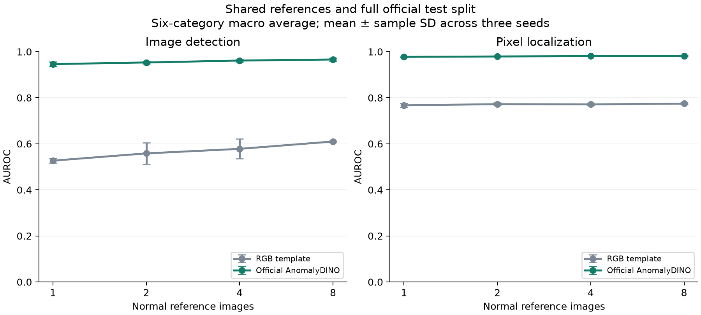
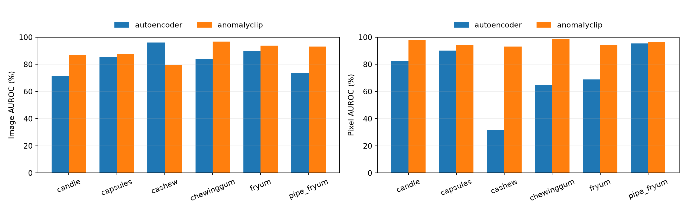
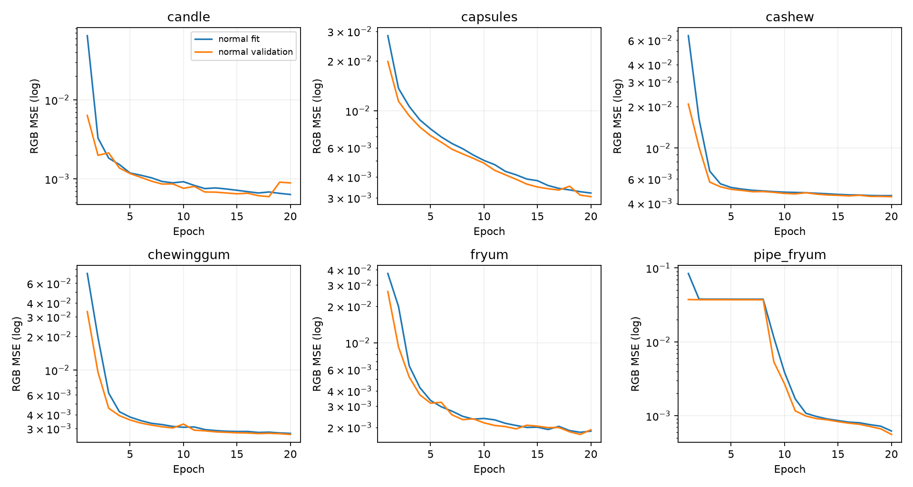
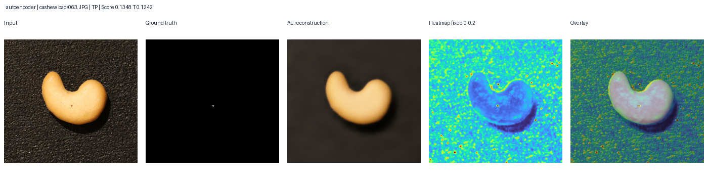
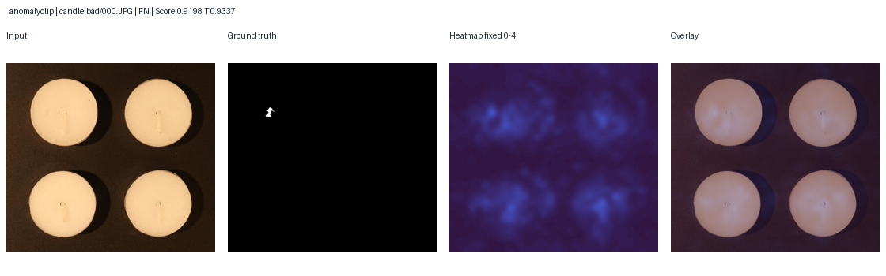

# Part 1 / Part 2 measured results

All methods evaluate the same six required VisA categories and official 1cls test
split: 360 normal + 600 anomalous images. Test masks enter evaluation only.
AUROC is a ranking metric, not thresholded classification accuracy.

## Required, matched-reference experiments

Each method has 72 configurations: six categories, shots 1/2/4/8, reference groups
0/1/2. The exact reference filenames and 20 independent normal calibration images
per category are in `configs/reference_manifest.json`.

Values are percentages; mean +/- sample standard deviation over three reference
groups, after equal category averaging within each group.

| Shots | Template Image AUROC | AnomalyDINO Image AUROC | Template Pixel AUROC | AnomalyDINO Pixel AUROC |
|---:|---:|---:|---:|---:|
| 1 | 52.67 +/- 0.97 | 94.61 +/- 1.03 | 76.71 +/- 0.84 | 97.76 +/- 0.07 |
| 2 | 55.84 +/- 4.65 | 95.33 +/- 0.57 | 77.22 +/- 0.60 | 97.92 +/- 0.08 |
| 4 | 57.80 +/- 4.31 | 96.15 +/- 0.49 | 77.12 +/- 0.38 | 98.09 +/- 0.03 |
| 8 | 61.00 +/- 0.36 | 96.62 +/- 0.70 | 77.46 +/- 0.39 | 98.21 +/- 0.02 |

At the fixed normal-only calibrated thresholds, pooled 4-shot AnomalyDINO accuracy
is 87.33% over 2,880 predictions (960 test images repeated over three reference
groups). This differs from its 96.15% macro Image AUROC.

## Separate optional extensions

| Part | Method | Image AUROC (%) | Pixel AUROC (%) | Fitting / supervision |
|---|---|---:|---:|---|
| 1 | Compact convolutional autoencoder | 83.36 | 72.20 | 2,813 normal fitting + 312 normal validation images; six models, 20 epochs each |
| 2 | AnomalyCLIP | 89.54 | 95.81 | Official MVTec-trained prompts; zero VisA fitting/reference images |

Both additionally use the prescribed 20 normal calibration images per category.
These optional experiments each have one prespecified seed, not a three-seed
stability estimate. Their supervision differs from the required few-shot methods.
AnomalyCLIP uses square 448 resizing rather than aspect-preserving geometry and
does not claim an exact reproduction of the upstream default square-518 setting.

The autoencoder can reconstruct the product while smoothing textured normal
background. For cashew its Image AUROC is 95.98%, but Pixel AUROC is only 31.56%:
large residuals on non-defect background undermine localization. The following
test image is classified TP, which does not establish correct defect localization.

AnomalyCLIP's global image-text score and local similarity maps are separate
outputs. The tiny defect in candle bad/000.JPG remains a false negative at its
prescribed calibration threshold.

## Serial same-input latency comparison

RTX 4060 Laptop 8GB; 120 fixed test inputs per method, ten normal and ten anomalous
images per category. Timing includes decode, preprocessing, inference/matching,
score and original-size map restoration; excludes setup, training, output I/O and
metric calculation. These are fresh serial measurements, not mixed timer scopes.

| Method | Mean ms/image | Peak allocated GPU MiB |
|---|---:|---:|
| Template, 4-shot/group 0 | 28.21 | 0 |
| AnomalyDINO, 4-shot/group 0 | 211.77 | 120.48 |
| Autoencoder | 48.47 | 26.81 |
| AnomalyCLIP | 222.10 | 1,879.25 |

Small numeric source tables are in [published_results](published_results/).
Full per-image CSVs, floating anomaly maps, model checkpoints and audit outputs
are generated under `results/` when running the documented commands and remain
excluded from Git to keep the source repository small. There is no Part 3 result yet.
