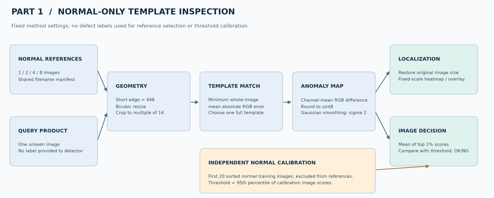
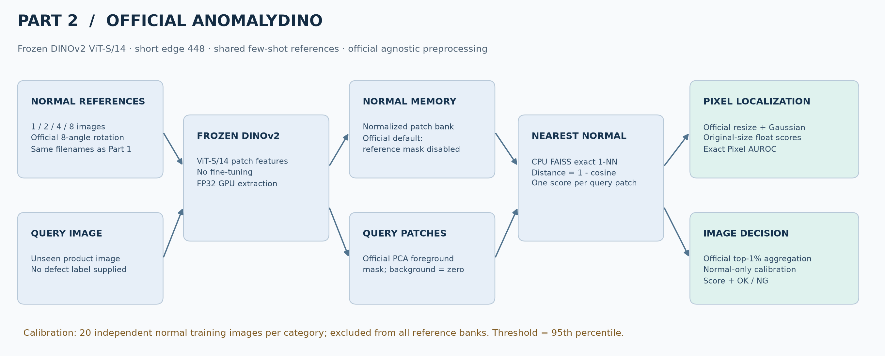

# Part 1、Part 2：工作流程与结果总结

更新日期：2026 年 11 月 12 日。此为公开仓库版本；完整本地输出需运行实验生成，公开摘要见 [RESULTS.md](RESULTS.md)。范围：已完成的必做实验及两个可选扩展；Part 3 尚未开展。

## 先看这一页：我们完成了什么

本项目要解决的是：**给定正常产品的参考图片，判断一张新图片是否有缺陷，并标出缺陷位置。**

每次检测输出三项：异常分数 Score、根据阈值得到的 OK/NG 判断、像素异常热力图。

| 所属部分 | 方法 | 是否在本项目数据上训练网络 | 当前状态 |
|---|---|---|---|
| Part 1 必做 | RGB 模板差分 | 不训练，直接与正常模板比较 | 六类、1/2/4/8-shot、三个参考组全部完成 |
| Part 1 选做 | 卷积自编码器 | 只用正常图训练，每类一个模型 | 六个模型各训练 20 轮，完整测试完成 |
| Part 2 必做 | 官方 AnomalyDINO | DINOv2 冻结，只建立正常特征库 | 六类、1/2/4/8-shot、三个参考组全部完成 |
| Part 2 选做 | AnomalyCLIP | VisA 上不训练，使用外部训练好的提示权重 | 六类零目标参考图测试完成 |

**Part 1 自编码器和 Part 2 AnomalyCLIP 是两个独立算法，没有融合成一个模型。**
代码分别放在 [Part1](../Part1/README.md) 和 [Part2](../Part2/README.md)，各有独立运行入口和 Demo。

## 一、共同的数据准备与实验规则

### 1. 数据从哪里来

使用已经下载的 VisA 数据集，只取课程要求的六类。
训练和测试严格读取官方 `data/VisA/split_csv/1cls.csv`，没有自己重新随机划分。

| 类别 | 正常训练图 | 正常测试图 | 异常测试图 |
|---|---:|---:|---:|
| candle | 900 | 100 | 100 |
| capsules | 542 | 60 | 100 |
| cashew | 450 | 50 | 100 |
| chewinggum | 453 | 50 | 100 |
| fryum | 450 | 50 | 100 |
| pipe_fryum | 450 | 50 | 100 |
| 合计 | **3,245** | **360** | **600** |

正式测试集共有 **960 张不同图片**。正常训练集不含异常图片。
异常测试图有 ground truth 标注：**白色是缺陷区域，黑色是非缺陷区域**。
正常测试图的标注定义为全黑。标注只用于评估和展示，不是模型的输入。

### 2. 正常参考图、校准图、测试图各做什么

| 图片角色 | 用途 | 是否用于计算正式测试指标 |
|---|---|---|
| 正常参考图 | Part 1 当模板；AnomalyDINO 建立正常特征库 | 否 |
| 每类 20 张正常校准图 | 设置 OK/NG 分界线 | 否 |
| 正式测试图片 | 检验正常/异常判别及缺陷定位 | 是 |

每类正常训练文件按文件名排序，先取前 **20 张**独立保留为校准图。
它们不进入模板或正常特征库，也不参与自编码器的训练、验证。

对某个已经建立好的检测方法，逐张检测这 20 张正常图，得到 20 个分数，取第 **95 百分位数**作为阈值。
实际使用 `Score > Threshold` 判为 NG，否则为 OK。不同类别、方法和参考组分别计算自己的阈值。
20 张样本得到的是经验阈值，不能保证新图片的误报率恰好为 5%。

若校准图也进入参考库，就可能与自己匹配，得到过低分数，使阈值失真，因此要分开。

### 3. 1、2、4、8-shot 和 24 张候选图是什么意思

Part 1 模板基线与 Part 2 AnomalyDINO 使用**完全相同的参考图片名单**。
每类分别评估 1、2、4、8 张正常原始参考图，每种数量运行 seed 0、1、2 三个参考组。

选图遵循官方程序的排序切片规则：先排除 20 张校准图，再从排序后的候选池选择：

```text
某一组的参考图 = pool[seed × shot : (seed + 1) × shot]

以 8-shot 为例：
seed 0：候选池第 1～8 张
seed 1：候选池第 9～16 张
seed 2：候选池第 17～24 张
```

这里 seed 是官方选图规则中的组编号，不是我们额外重新随机抽样。
覆盖三个 8-shot 组需要 24 张不同图片，其他 shot 的参考也包含在这 24 张里。
**每次只用当次指定的 1、2、4 或 8 张，不会一次用全部 24 张。**

Part 1 数据目录保存完整官方训练集；Part 2 的专用目录只保留所需的 24 张候选参考图。
文件夹里存多少张，不等于某次实验实际用多少张。
具体名单已固定在 [reference_manifest.json](../configs/reference_manifest.json)。

每个必做方法共有 `6 类 × 4 种 shot × 3 个参考组 = 72 组配置`，
累计 **11,520 条测试预测**。同一测试图会在不同配置下重复检测，所以不是 11,520 张不同图片。

## 二、Part 1：我们具体做了什么

### A. 必做方法：RGB 模板差分

**核心想法：用正常产品图片作为模板，测试图片与正常模板差得越多，越可疑。**

```text
选定正常模板 → 对测试图和模板做相同尺寸处理 → 选最接近的完整模板
→ 计算逐像素 RGB 差异 → 平滑得到热力图 → 汇总整图分数
→ 用独立正常校准图设置阈值 → 输出 OK/NG → 用测试标注评估
```

具体实现：

1. 图片短边缩放到 448，保持纵横比，再从底部/右侧裁到 14 的整数倍，与 AnomalyDINO 的输入几何对齐。
2. 对每个候选模板计算全图 RGB 平均绝对差，选差异最小的一张完整模板。
3. 计算这张模板与测试图的逐像素 RGB 绝对差，对三个颜色通道求平均。
4. 将差异图四舍五入为 0～255 的 uint8 数值图，并进行 sigma=2 的高斯平滑。
5. 最高约 1% 像素差值的平均值 / 255，作为整张图片的异常分数。
6. 使用独立校准阈值得到 OK/NG，将异常图恢复至原图尺寸后评估定位。

本方法不训练神经网络，也没有额外进行图片配准或参考图旋转增强。



**已经补充的分析：**正常模板与测试图对照、分数分布与阈值、TP/TN/FP/FN 案例，
并固定保存 22 张代表性图片，供后续方法按同一张图比较。

主要局限是对位置、轮廓和排列变化敏感。例如，正常胶囊的摆放方式不同也可能产生明显差异；
细微缺陷又可能被更大的正常外观差异盖住。不能简单靠降低阈值同时解决漏检与误报。

### B. Part 1 可选扩展：卷积自编码器

**核心想法：只用正常图片学习“正常图片如何被重建”，再把重建不好的位置作为异常线索。**

```text
正常训练图片 → 划分拟合/正常验证集 → 训练小型卷积自编码器
→ 按正常验证损失选择模型 → 重建测试图 → 计算原图与重建图的差异
→ 热力图和整图分数 → 正常校准阈值 → OK/NG 与正式测试评估
```

每类训练一个模型，共六个；每个模型 342,539 个参数，没有跳跃连接。
固定训练 20 轮，batch size=8，Adam 学习率 0.001，训练 seed=111。
训练损失是 RGB 均方误差 MSE；只按正常验证集的最低 MSE 选 checkpoint，不按测试效果挑模型。

| 类别 | 实际拟合图 | 正常验证图 | 额外校准图 |
|---|---:|---:|---:|
| candle | 792 | 88 | 20 |
| capsules | 470 | 52 | 20 |
| cashew | 387 | 43 | 20 |
| chewinggum | 390 | 43 | 20 |
| fryum | 387 | 43 | 20 |
| pipe_fryum | 387 | 43 | 20 |
| 合计 | **2,813** | **312** | **120** |

推理时，计算 RGB 绝对重建误差并做 sigma=2 平滑，最高约 1% 残差的平均值作为整图分数。
工作分辨率与模板方法相同。每轮训练损失、拟合/验证/校准名单、最佳模型和重建图均已保存。

**它使用很多张正常图进行训练，属于额外的重建基线，不能称为 4-shot 方法。**

实测说明：cashew 的 Image AUROC 达到 95.98%，但 Pixel AUROC 只有 31.56%。
实际图片中，自编码器把粗糙背景重建得较平滑，使正常背景产生大量残差。
这说明“整张图判断正确”不等于“准确找到了缺陷”。低分和失败案例均保留，没有反转热力图来提高测试分数。

## 三、Part 2：我们具体做了什么

### A. 必做方法：官方 AnomalyDINO 复现

**核心想法：比较局部视觉特征是否像正常产品，而不是要求测试图与模板逐像素对齐。**

```text
同一批正常参考图 → 冻结的 DINOv2 提取局部特征 → 建立正常特征记忆库
测试图 → 相同 DINOv2 提取局部特征 → 每个 patch 找最近的正常特征
→ 距离组成异常图 → 汇总图像异常分数 → 独立校准阈值 → 评估并与模板逐图比较
```

复现使用官方 AnomalyDINO 与 DINOv2 代码，固定版本和权重校验值。
骨干为 **DINOv2 ViT-S/14**，权重冻结，FP32，短边 448，官方 `agnostic` 处理。
没有在 VisA 上微调骨干，也没有训练新分类头。

关键步骤：

1. 复用 Part 1 的参考与校准名单，完整运行 1/2/4/8-shot 和三个参考组。
2. 参考图按官方方法生成八个旋转视图后提取特征。4-shot 仍然指四张原始图片，增强不会改变原始参考图计数。
3. 测试图使用官方 PCA 前景掩码；保留官方默认设置，不额外屏蔽参考库背景。
4. 在 CPU 上用 FAISS 做精确最近邻检索，正常特征越难匹配的局部，异常距离越高。
5. 按官方最高约 1% patch 距离求图像分数，并将 patch 距离恢复成原图尺寸的热力图。
6. 保存原始浮点 patch 图；正式像素指标由这些数值重建，不使用彩色截图算指标。



由于 DINOv2 已在大规模预训练中学习视觉表征，少量正常参考图就能用于检索比较；
这不意味着只用几张图片从头训练出了整个视觉网络。

目前仍存在细小、低对比度缺陷漏检等问题。一个 patch 里混有大量正常结构时，缺陷特征可能被稀释。
先前固定的 22 张案例和五张 AnomalyDINO 困难案例都已保留，用于展示提升、剩余错误和新增退步。

### B. Part 2 可选扩展：AnomalyCLIP

**核心想法：用预先学好的“正常/异常”文本提示，与图片和局部特征比较。**

```text
官方 CLIP 骨干 + 官方已训练的正常/异常提示 → 冻结模型
→ 测试图片的全局/局部视觉特征与文本比较
→ 全局异常概率 + 多层局部热力图 → 独立正常校准阈值 → 正式测试评估
```

使用官方发布的 `9_12_4_multiscale_visa/epoch_15.pth` 提示权重，
其发布脚本对应 **在外部 MVTec AD 上训练、在 VisA 上评估**。
外部源域训练使用正常与异常标注；没有用我们的 VisA 测试标签训练或选择提示。
CLIP 骨干与提示权重均记录来源和 SHA256。

本次 VisA 上的网络拟合图数为 **0**，正常参考库图片数也为 **0**；
每类额外 20 张正常图片只用于设置 Demo 阈值。

使用 ViT-L/14@336px 骨干、官方 DPAM 设置、6/12/18/24 四层局部特征。
图像分数是官方全局图文异常概率；热力图来自四层局部相似度图，因此局部亮点不必然对应整图 NG。

本次输入设为 **448×448 方形缩放**，官方测试默认是 518 方形。
它与两个必做方法保持纵横比的输入几何不同，因此作为单独的零目标参考图扩展展示，
不声称是官方 518 设置的精确复现，也不作为严格同条件 few-shot 排名。

## 四、结果如何读

### 1. 指标含义

| 指标或记录 | 表示什么 |
|---|---|
| Image AUROC | 图像异常分数能否把异常图排在正常图前面，是课程主指标 |
| Pixel AUROC | 像素异常分数能否把缺陷区域排在非缺陷区域前面 |
| Accuracy | 使用当前阈值后，实际有多少图片被正确判成 OK/NG |
| TP / TN | 异常正确检出 / 正常正确通过 |
| FP / FN | 正常误报为异常 / 异常漏报为正常 |

**AUROC 不是准确率；98% Pixel AUROC 也不是“98% 像素分类正确”。**
AUROC 使用阈值划分前的原始分数。调整一个 OK/NG 阈值通常不会改变 AUROC。
不同方法的分数尺度不同，不能直接拿两个方法的原始 Score 大小判断谁更好。

像素指标纳入全部正常测试图的全零标注。每类单独计算，再对六类等权平均。
必做方法先对每个 seed 的六类指标等权平均，再报告三个 seed 的均值和样本标准差。
两个可选方法各只做一个预先固定的 seed，不虚构三次重复实验的标准差。

### 2. 必做方法：完全相同参考图和测试集上的比较

数值单位为百分数，表内为三个参考组的均值 ± 标准差。

| Shot | 模板 Image AUROC | AnomalyDINO Image AUROC | 模板 Pixel AUROC | AnomalyDINO Pixel AUROC |
|---:|---:|---:|---:|---:|
| 1 | 52.67 ± 0.97 | 94.61 ± 1.03 | 76.71 ± 0.84 | 97.76 ± 0.07 |
| 2 | 55.84 ± 4.65 | 95.33 ± 0.57 | 77.22 ± 0.60 | 97.92 ± 0.08 |
| 4 | 57.80 ± 4.31 | 96.15 ± 0.49 | 77.12 ± 0.38 | 98.09 ± 0.03 |
| 8 | 61.00 ± 0.36 | 96.62 ± 0.70 | 77.46 ± 0.39 | 98.21 ± 0.02 |

4-shot 的 Image AUROC 从 57.80% 提升到 96.15%，增加 **38.35 个百分点**。
但 AnomalyDINO 4-shot 在当前阈值下的实际判对率约为 **87.33%**；
该准确率按六类、三个参考组的 2,880 条预测合并计算，不能与 AUROC 混为一谈。

在全部 11,520 条配置配对记录中，Part 2 纠正了 5,673 条原有错误，也产生了 761 条新增错误。
这些记录包含同图在不同配置下的重复检测，不是对应数量的不同图片。

### 3. 可选方法：单独报告训练条件

| 所属部分 | 扩展 | Image AUROC | Pixel AUROC | 训练/监督条件 |
|---|---|---:|---:|---|
| Part 1 | 卷积自编码器 | 83.36% | 72.20% | 2,813 张正常拟合图 + 312 张正常验证图 |
| Part 2 | AnomalyCLIP | 89.54% | 95.81% | 外部 MVTec 监督提示；VisA 拟合及参考图均为 0 |

整体上，当前 AnomalyDINO 的检测和定位表现最好。
两个扩展帮助比较“像素差异、正常图重建、预训练视觉特征、图文提示”四种不同思路。
训练样本数量、外部监督和预处理不相同，所以不把扩展表当作严格同条件的 few-shot 排名。

### 4. 同一台电脑上的速度与显存

设备：RTX 4060 Laptop 8GB。按每类前 10 张正常、前 10 张异常图片，
四种方法分别串行、重新推理同一批 120 张输入。
计时含读取、预处理、特征/重建、打分及原图异常图恢复；不含建库、训练、模型加载和写文件。

| 方法 | 平均 ms/图 | 峰值 GPU 分配显存 MiB |
|---|---:|---:|
| 模板差分，4-shot/seed 0 | 28.21 | 0 |
| AnomalyDINO，4-shot/seed 0 | 211.77 | 120.48 |
| 自编码器 | 48.47 | 26.81 |
| AnomalyCLIP | 222.10 | 1,879.25 |

这里的 GPU 显存是 PyTorch 统计值，不是整个显卡进程或驱动的总占用。
速度是同设备比较，方法仍保留各自声明的输入和训练条件。

## 五、代码与结果分别在哪里

### Part 1

| 要查看的内容 | 文件或目录 |
|---|---|
| Part 1 独立入口说明 | [Part1/README.md](../Part1/README.md) |
| 必做模板核心实现 | [anomaly_baseline/core.py](../anomaly_baseline/core.py) |
| 模板实验与评估 | [anomaly_baseline/run.py](../anomaly_baseline/run.py) |
| 自编码器结构、训练和预测 | [Part1/autoencoder/model.py](../Part1/autoencoder/model.py) |
| 自编码器独立实验入口 | [Part1/autoencoder/run.py](../Part1/autoencoder/run.py) |
| 模板完整结果 | results/part1/report.html（本地生成：`results/part1/report.html`） |
| 模板失败案例与分布 | results/part1/supplement/index.html（本地生成：`results/part1/supplement/index.html`） |
| 自编码器逐图结果 | results/part1_autoencoder/predictions_all.csv（本地生成：`results/part1_autoencoder/predictions_all.csv`） |
| 自编码器模型与逐轮记录 | `results/part1_autoencoder/<类别>/best.pt`、`training_history.csv`、`training_images.csv` |

### Part 2

| 要查看的内容 | 文件或目录 |
|---|---|
| Part 2 独立入口说明 | [Part2/README.md](../Part2/README.md) |
| AnomalyDINO 官方调用与适配 | [anomaly_dino/official.py](../anomaly_dino/official.py)、[run.py](../anomaly_dino/run.py) |
| AnomalyCLIP 实现与权重配置 | [Part2/anomalyclip/model.py](../Part2/anomalyclip/model.py) |
| AnomalyCLIP 独立实验入口 | [Part2/anomalyclip/run.py](../Part2/anomalyclip/run.py) |
| AnomalyDINO 完整结果 | results/part2/report.html（本地生成：`results/part2/report.html`） |
| AnomalyCLIP 逐图结果 | results/part2_anomalyclip/predictions_all.csv（本地生成：`results/part2_anomalyclip/predictions_all.csv`） |
| Part 1 → Part 2 逐图变化 | part1_vs_part2.csv（本地生成：`results/comparisons/part1_vs_part2.csv`） |

跨方法结果页面是 results/extensions/report.html（本地生成：`results/extensions/report.html`）。
这是统一查看入口，不代表算法融合。`experiment_utils/` 只共享数据读取、评估、日志和窗口组件。

每种方法的 `predictions_all.csv` 可查分数、阈值、真实标签和 TP/TN/FP/FN；
`errors_only.csv` 只保留错误；`summary_macro.csv` 是整体指标。
热力图 PNG 用于展示，原始数值图另行保存，不能用彩色图代替原始结果算指标。

数据隔离、参考名单、模型校验、指标与逐图输出已经核验；15 项测试通过。
分目录后，两个独立扩展 Demo 的实时预测已重新检查，与保存的批量分数一致。

## 六、怎样打开各自的 Demo

在项目根目录的 PowerShell 中，按需要运行一条命令：

```powershell
# Part 1 必做：模板差分
.\.venv-part2\Scripts\python.exe Part1/demo_baseline.py

# Part 1 选做：自编码器；显示原图、重建图、热力图、叠加图
.\.venv-part2\Scripts\python.exe Part1/demo_autoencoder.py

# Part 2 必做：AnomalyDINO
.\.venv-part2\Scripts\python.exe Part2/demo_anomalydino.py

# Part 2 选做：AnomalyCLIP；显示原图、热力图、叠加图
.\.venv-part2\Scripts\python.exe Part2/demo_anomalyclip.py
```

同一时间通常只开一个窗口，选择与产品对应的类别，再选产品图片。
不要选择 ground truth 掩码作为输入。看案例时同时检查分数、阈值与热力图，不能只看整图是否判对。

## 七、四分钟预录可以怎样组织

Reminder 要求至少完成 Part 1，最好完成 Part 2，并介绍方法、实验和下一步计划。
当前已经完成两部分必做和上述两个可选扩展。四分钟内宜突出主线，扩展简要带过：

| 时间 | 内容 |
|---|---|
| 0:00–0:30 | 任务：正常参考图片 → 异常判断与缺陷定位；数据为六类 VisA |
| 0:30–1:15 | Part 1：模板差分流程，展示一个正常外观变化或小缺陷导致的失败 |
| 1:15–2:15 | Part 2：冻结 DINOv2 的局部特征与最近邻检索；展示同图前后对比 |
| 2:15–3:00 | 主结果：1/2/4/8-shot 表格，说明 AUROC、参考组稳定性和剩余漏检 |
| 3:00–3:35 | 两个独立扩展：自编码器重建与 AnomalyCLIP 图文比较，交代不同监督条件 |
| 3:35–4:00 | 当前局限与下一步：针对一个具体失败模式开展 Part 3，保留 Part 2 作为对照 |

Part 3 目前只是下一步计划，不应在预录中说成已经完成。

## 依据与进一步阅读

- 项目说明（课程发放资料，不随公开代码分发）：第 3 页为 Part 1/2 方法和可选扩展，第 4 页为数据与评价规则。
- Reminder（课程发放资料，不随公开代码分发）：第 4–5 页为四分钟展示及介绍内容要求。
- [AnomalyDINO 详细复现记录](../docs/part2_method.md)、[扩展方法和权重来源](../docs/optional_extensions.md)。
- 官方代码：[AnomalyDINO](https://github.com/dammsi/AnomalyDINO)、[DINOv2](https://github.com/facebookresearch/dinov2)、[AnomalyCLIP](https://github.com/zqhang/AnomalyCLIP)。

本文件中的数值来自本地保存的完整实验结果。目录调整没有重新训练或改动既有异常分数。
