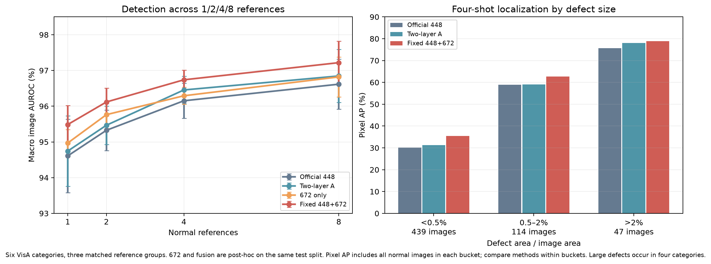

# Project 2：Part 3 复查意见完成记录（2026-11-23）

> 历史记录：本文件的旧测速数据及部分表格描述已被 2026-11-24 的统一测速和报告修订取代。最新版本见 `STRICT_REVIEW_V3_RESPONSE_2026-11-24.md` 与 `main.pdf`。

本文件逐项回应 `aiaa3201_project2_part3_review_and_ideas.md`，记录实际完成的实验、报告修改和仍需谨慎解释的边界。所有百分比均来自本地保存的实验记录，而不是根据截图估算。实验对照采用 VisA 六类、相同的正常参考图文件名、1/2/4/8 张参考图、参考组 0/1/2，以及与参考库互斥的每类 20 张正常阈值校准图。

## 一、报告版式和信息修正

| 复查意见 | 本次处理 |
| --- | --- |
| Figure 2 放大图刻度与主图重叠 | 调整放大图位置并重新生成 `report/figures/shot_curves.pdf`；检查了渲染页。 |
| Table 3 需突出每对较优值 | 逐行加入蓝色加粗标识，并让表注与实际标识一致；重新编译后优胜值可辨认。 |
| Table 7 的结果列两端对齐造成空白 | 改成左对齐段落列，重新渲染后间距正常。 |
| 模板与作者栏 | `report/main.tex` 已加载项目内的官方 CVPR `cvpr.sty`。按照组员当前指示，英文姓名、学号和学院仍保留占位，提交前须填写真实信息。 |

更新后的 `report/main.pdf` 共 9 页，正文与结论在第 8 页结束，参考文献延续至第 9 页。新增实验表、讨论和结论均已纳入 PDF。报告仍把原先预先固定的双层特征方法 A 作为主要受控比较，把后验开发的 448+672 分支明确标为探索性结果。

## 二、针对“Part 3 提升小”的实测补充

### 1. 完整的无训练多尺度实验

在官方冻结的 `dinov2_vits14` 基础上增加短边 672 的图像尺度，并与原 448 分支做固定 50/50 分数融合。两个分支各自用相同 20 张正常校准图估计阈值，先用各自阈值归一化，再对融合后的 20 张正常分数取第 95 百分位作为最终 OK/NG 阈值。参考图、校准图和测试图逐张配对；测试标签未用于设定融合权重或阈值。672 查询特征缓存与旧四张参考图结果的六个逐张分数核对，误差均小于 `1e-6`。

| 正常参考图数 | 官方 DINO 图像 AUROC | 双层 A | 单独 672 | 固定 448+672 | 官方 FP+FN | 融合 FP+FN |
| ---: | ---: | ---: | ---: | ---: | ---: | ---: |
| 1 | 94.61 ± 1.03% | 94.74 ± 0.99% | 94.97 ± 0.38% | **95.49 ± 0.54%** | 442 | 404 |
| 2 | 95.33 ± 0.57% | 95.47 ± 0.54% | 95.76 ± 0.38% | **96.12 ± 0.39%** | 384 | 368 |
| 4 | 96.15 ± 0.49% | 96.45 ± 0.38% | 96.29 ± 0.24% | **96.74 ± 0.27%** | 365 | 362 |
| 8 | 96.62 ± 0.70% | 96.85 ± 0.74% | 96.82 ± 0.56% | **97.22 ± 0.60%** | 340 | 321 |

每一档都是六类 × 三组的 **18 个设置**，`±` 是三组“六类宏平均”的样本标准差。每档的错判总数对应 2,880 次逐张预测；实际上仍是同一批 960 张测试图片在三组参考库下重复评估。多尺度在四档宏平均 AUROC 上都提升，但四张参考图时 `chewinggum` 和 `pipe_fryum` 分别比官方方法低约 **0.03 / 0.67 个百分点**，阈值错判总数也仅减少 **3** 次，不能把 AUROC 提升等同于各类都改善或可靠的自动判定。配对的 120 张图片实测查询时间从 448 的 **235 ms/张**增加到完整两尺度的 **833 ms/张**，约 **3.55 倍**；两者均含解码、特征提取、检索和异常图恢复，不含模型及参考库准备。

逐张转移也已记录到 CSV，便于查找具体由错变对及由对变错的图片：

| 正常参考图数 | 漏检改正确 `FN→TP` | 正确变漏检 `TP→FN` | 误报改正确 `FP→TN` | 正确变误报 `TN→FP` |
| ---: | ---: | ---: | ---: | ---: |
| 1 | 70 | 27 | 34 | 39 |
| 2 | 68 | 19 | 27 | 60 |
| 4 | 49 | 12 | 19 | 53 |
| 8 | 48 | 7 | 30 | 52 |

融合方法的**原图尺寸像素**指标也完成了全部 72 个设置；全部正常测试图仍以全零 mask 参与评估。官方方法的像素 AUROC 来自原 Part 2 全量结果，像素 AP 的逐档数值只对融合方法另行计算，不能误认为有逐档官方 AP 对照。

| 正常参考图数 | 融合像素 AUROC，三组宏平均 | 官方像素 AUROC | 融合像素 AP，三组宏平均 |
| ---: | ---: | ---: | ---: |
| 1 | 98.19 ± 0.08% | 97.76% | 48.92 ± 0.56% |
| 2 | 98.32 ± 0.08% | 97.92% | 50.26 ± 1.13% |
| 4 | 98.46 ± 0.05% | 98.09% | 51.89 ± 0.65% |
| 8 | 98.56 ± 0.03% | 98.21% | 52.59 ± 0.87% |

### 2. 精确像素 AP：补齐 A+AnyUp 三组

四张参考图、三组、原图尺寸、全部正常测试图使用全零 mask，结果如下：

| 方法 | 像素 AP，六类宏平均 | 像素 AUROC，六类宏平均 | 是否改变图像判定 |
| --- | ---: | ---: | --- |
| 官方 DINO | 47.93 ± 0.48% | 98.09 ± 0.03% | 原始判定 |
| 双层 A | 48.59 ± 0.30% | 98.12 ± 0.05% | 是，A 的分数重新计算 |
| A+AnyUp | **58.69 ± 0.38%** | **98.63 ± 0.05%** | 否，AnyUp 只恢复异常图 |
| 固定 448+672 | 51.89 ± 0.65% | 98.46 ± 0.05% | 是，融合分数及阈值重新计算 |

A+AnyUp 相比 A 的像素 AP 提升 **10.10 个百分点**，并非先前只有 seed 0 的 +10.41 个百分点。它使用额外预训练 AnyUp 权重，对检索后的分数图做放大，**没有**在最近邻检索前上采样特征；因此不能称为已验证的“特征级 AnyUp”，也不会修复图像级漏检。配对 120 张图片、四张参考图/group 0 的查询时间为 **382 ms/张**，相对官方 DINO 的 **178 ms/张**；峰值已分配 GPU 内存约 **990 MiB** 对 **124 MiB**。像素 AP 比较已由单组扩为完整三组；其余档位的融合像素结果见下文数据文件。

### 3. 按缺陷面积分桶

600 张不同的异常测试图中：微小缺陷 `<0.5%` 有 **439** 张，中等 `0.5%–2%` 有 **114** 张，大缺陷 `>2%` 有 **47** 张。四张参考图、三组结果中，微小缺陷的官方 DINO 图像 AUROC / 正常阈值召回为 **95.18% / 85.66%**；固定 448+672 为 **95.96% / 88.17%**。这表明小缺陷是主要难点之一，但不能仅凭相关性证明“14 像素 patch”是每个漏检的因果原因。

精确原图尺寸像素 AP 的同档比较：

| 缺陷面积档 | 官方 DINO | 双层 A | 固定 448+672 | 涉及类别/参考组单元 |
| --- | ---: | ---: | ---: | ---: |
| `<0.5%` | 30.08% | 31.21% | **35.43%** | 18 |
| `0.5%–2%` | 58.92% | 59.04% | **62.68%** | 18 |
| `>2%` | 75.68% | 78.09% | **78.92%** | 12（仅四类有样本） |

每一档都包括该类全部正常测试图及本档异常图；跨档阳性像素比例不同，**不能把不同档位的 AP 绝对值直接当作难度排名**。可以在同一档内比较方法。

### 4. Top-k 与阈值估计诊断

保存的四张参考图 patch 图在三个参考组上做了后验聚合扫描。把全图 Top-1% 改为 Top-0.5% 时，官方 DINO 图像 AUROC 从 **96.15%**到 **96.46%**，双层 A 从 **96.45%**到 **96.65%**；但前景中位数去偏使结果下降到约 **95.86%–95.90%**。这只是利用同一测试集的机理诊断，**未**重新按正常校准图设置阈值，因此不是可直接部署的改进。

同一批 20 张正常图还用于阈值估计对照：经验第 95 百分位、`mean + 1.645 × sample SD`、拟合 Gumbel 分布的第 95 百分位。200 次只从正常校准分数重采样，记录阈值波动，再在测试集上回顾 FP/FN；官方 DINO 三种规则分别为 **154/211、152/194、142/190**，固定多尺度分别为 **188/174、186/178、183/180**。后两种分布假设未被 20 个样本充分验证，**不能按测试集错判选出“最好”的部署阈值**。两种方法的分数尺度不同，其阈值标准差也不能直接横比。

### 5. 不依赖 AnomalyCLIP 的人工复核分析

额外评估了仅用冻结 DINO 448/672 分数的选择性判定。以距离正常校准阈值的远近给样本排序，自动处理 90% 时，官方 448 的已处理错误率是 **10.39%**，多尺度为 **9.25%**；后者把 **53/174** 次漏检排入待人工复核队列。待复核案例不是自动改正的 TP。此实验也保存跨尺度一致性排序，90% 覆盖时错误率 **9.31%**，未超过简单融合边距。测试标签得到的 FPR 1%/5% 操作点仅用于回顾性评估，不是正常数据校准的部署阈值。

## 三、三条建议路线如何取舍

- **路线 1（分辨率与聚合）：** 已完成 672 与固定 448+672 的 72 设置全量图像级对照、四张参考图的三组像素定位、面积分桶、Top-k 和耗时实验。这是本轮实际推进的主路线。特征级 AnyUp 没有测试，报告没有冒充已完成。
- **路线 2（自距离归一化与 PCA 压缩）：** 本轮没有把它写成已实现的提升。对一张参考图而言，“到另一张正常参考图”的留一距离本身无定义，必须先另定 1-shot 规则。之前 B/E 的四张参考图单组试验未产生优于主线的准确率证据；PCA 压缩将改变 768 维距离，若要发表结论需另做完整配对检索与耗时实验。
- **路线 3（纯无监督选择性判定）：** 完成了不含外部异常标签的 DINO 阈值边距和跨尺度一致性回顾性评估。报告没有声称实现了建议中的全部三种不确定性指标，也没有将“待复核”计为正确识别。

## 四、核对文件与报告

- 报告 PDF：`report/main.pdf`；LaTeX：`report/main.tex`；图表源：`report/make_figures.py`、`report/make_followup_tables.py`。
- 全档位多尺度：`results/part3/multiscale_fusion/all_shots_summary.json`、`pixel_metrics_all_shots_3seeds.json`、`all_shots_category_seed.csv`、`all_shots_macro_by_seed.csv`、`all_shots_per_image_transitions.csv`。各类/档位/参考组子目录另有 `metrics.json`、`calibration.csv`、`predictions.csv`；两分支异常图保存在相应结果目录。
- 三组 A+AnyUp：`results/part3/a_anyup_pixel_ap_4shot_3seeds.json`。
- 面积分桶：`results/part3/defect_size_audit/summary.csv`、`pixel_ap_by_size_4shot.csv`。
- 聚合扫描：`results/part3/aggregation_screen/macro_mean_sd.csv`。
- 阈值估计：`results/part3/calibration_methods_4shot_3seeds/summary.csv` 和逐类逐组表。
- 纯 DINO 复核：`results/part3/pure_dino_reliability_4shot_3seeds/summary.json`、`per_image.csv`、`risk_coverage.csv`。
- 双图对照：`docs/figures/part3_followup_allshots.png`。
- 可随报告一起保存或提交的小型证据包：`report/evidence/`，含参考图清单、全 72 设置汇总、11,520 行逐张转移记录、三组像素结果、面积分桶与阈值/人工复核诊断；不含原始 VisA 图片或模型权重。

**解释边界：** 新的 672/融合候选来自已经查看过的同一 VisA 测试集；三组参考图能检查参考库波动，却不是独立测试集。A+AnyUp 用额外预训练权重，AnomalyCLIP 则用外部标注异常数据，它们与纯 DINO 多尺度不属于同等监督条件。作者栏按当前要求保留占位，待组员信息提供后替换。
